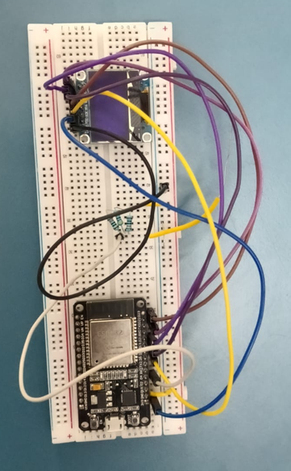
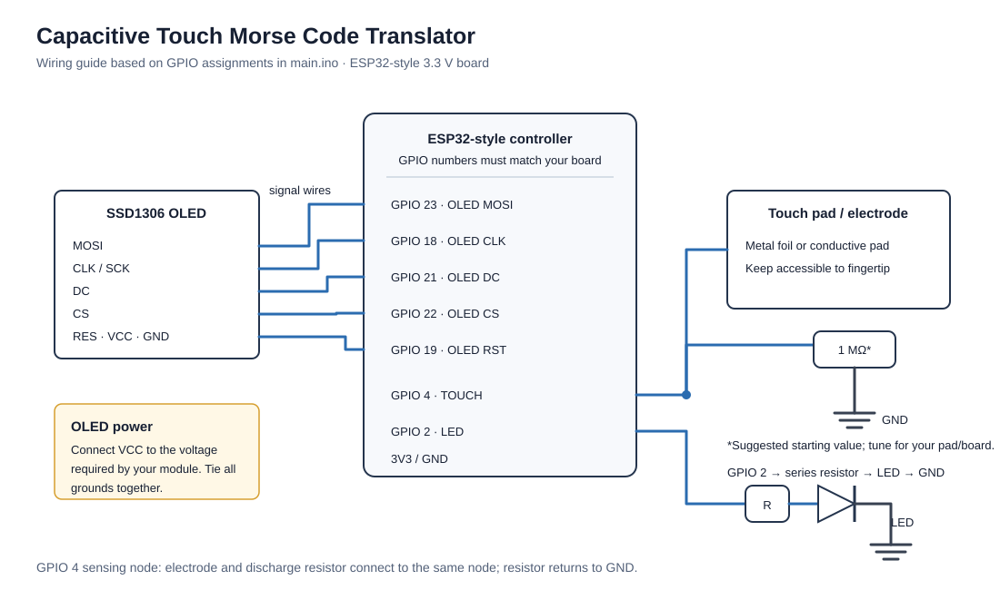

# Capacitive Touch Morse Code Translator

An Arduino sketch that turns a touch pad into a Morse code input. Short touches become dots, longer touches become dashes, and a pause ends the current letter. The decoded A–Z text is shown on an SSD1306 OLED. An LED indicates when the pad is being touched.

## Prototype



## Hardware

The pin assignments in `main.ino` are written for an ESP32-style board. Confirm that your board exposes these GPIO numbers and uses 3.3 V logic before wiring.

| Part | Connection | Notes |
|---|---|---|
| SSD1306 OLED | MOSI → GPIO 23 | Software SPI data |
| SSD1306 OLED | CLK/SCK → GPIO 18 | Software SPI clock |
| SSD1306 OLED | DC → GPIO 21 | Data/command |
| SSD1306 OLED | CS → GPIO 22 | Chip select |
| SSD1306 OLED | RES/RST → GPIO 19 | Display reset |
| SSD1306 OLED | VCC, GND | Use the voltage supported by your display module; share ground with the board |
| Touch electrode | GPIO 4 | The sketch charges this pin and measures its discharge time |
| Discharge resistor | GPIO 4 → GND | Suggested starting point: 1 MΩ; adjust experimentally for your pad and board |
| Indicator LED | GPIO 2 | Use a series resistor (e.g. 220–1,000 Ω) with an external LED; observe LED polarity. GPIO 2 may also drive a board's built-in LED. |

The resistor and touch electrode form a simple RC sensing node. A larger electrode or a finger near it changes the measured discharge time. The included schematic is a wiring guide; the exact touch-pad geometry and OLED power requirements depend on the modules used.

### Wiring schematic



Editable source: [`docs/wiring-schematic.drawio`](docs/wiring-schematic.drawio) (open with [diagrams.net](https://app.diagrams.net/)).

## Software setup

1. Install the Arduino IDE or Arduino CLI and the ESP32 board support package for your board.
2. Install these libraries using the Arduino Library Manager:
   - Adafruit GFX Library
   - Adafruit SSD1306
3. Open `main.ino`, select the matching ESP32 board and serial port, then upload.
4. Open the serial monitor at **115200 baud** if you need to view initialization messages.

The sketch uses the Adafruit SSD1306 constructor with software-SPI pins. It initializes the OLED, samples the untouched touch node 50 times, and then displays “Ready to type.” Keep the touch pad untouched during startup calibration.

## Using it

1. Wait for calibration to finish and the ready message to appear.
2. Tap the touch pad for a dot or hold it for a dash. The LED lights while the sketch detects a touch.
3. Pause after the final symbol of a letter. The sketch decodes and appends that letter to the OLED.

The Morse lookup currently supports **A–Z** only. Unknown patterns are discarded. The display/message buffer is cleared after it grows beyond 40 characters.

## How the sketch works

- **Touch measurement:** `getDrainTime()` drives GPIO 4 high briefly, switches it to input, and times how long it remains high (up to 10 ms).
- **Startup calibration:** `calibrateTouchSensor()` averages 50 untouched measurements. A measurement greater than the baseline plus `TOUCH_OFFSET` (5 µs) is treated as a touch.
- **Dot/dash classification:** a press shorter than the current `dotDashLimit` is a dot; a longer press is a dash. Presses of 30 ms or less are ignored as debounce.
- **Adaptive timing:** accepted dots update an exponential moving average of the dot duration. The dot/dash boundary is 2.5× that estimate; the letter pause is 4× it.
- **Letter decoding:** after the pause, the accumulated pattern is looked up in the A–Z Morse table and displayed.

These timings are starting values in the sketch, not universal settings. Tune `TOUCH_OFFSET`, `DEBOUNCE`, and the resistor/electrode arrangement if your board reports false touches or misses taps.

## Repository contents

```text
.
├── main.ino
├── README.md
├── docs/
│   ├── wiring-schematic.drawio
│   └── wiring-schematic.svg
└── images/
    └── prototype.png  
```

## Troubleshooting

- **OLED stays blank:** check its power, common ground, and all five signal pins; verify that the module is an SSD1306-compatible 128×64 display.
- **Display initialization fails:** confirm the Adafruit libraries and selected board are installed correctly.
- **Touch is always active or never registers:** check the GPIO 4 connection and common ground, keep the pad untouched during calibration, and tune the resistor and `TOUCH_OFFSET` for the physical setup.
- **LED does not respond:** check its polarity and series resistor, or confirm whether GPIO 2 is connected to an onboard LED on your board.

## License

See [`LICENSE`](LICENSE).
